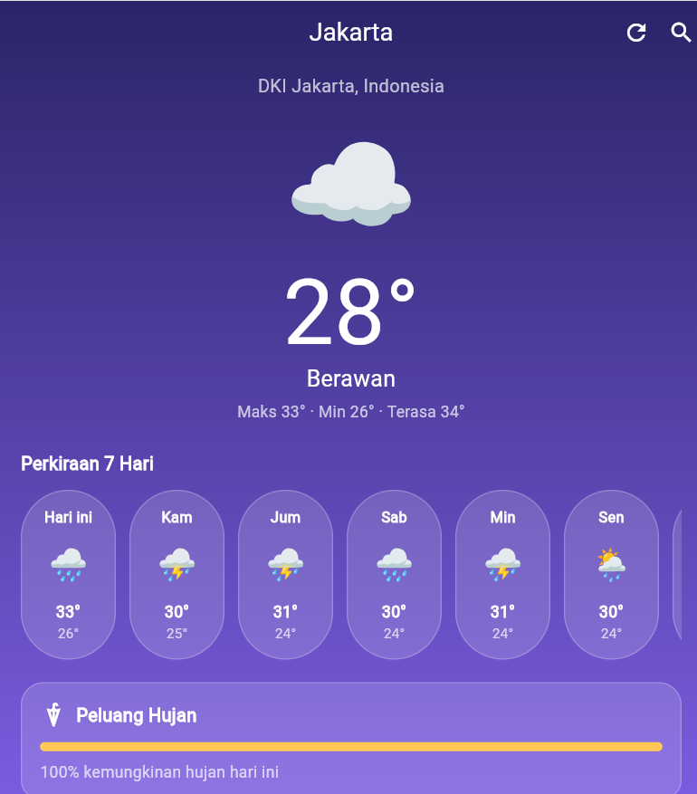
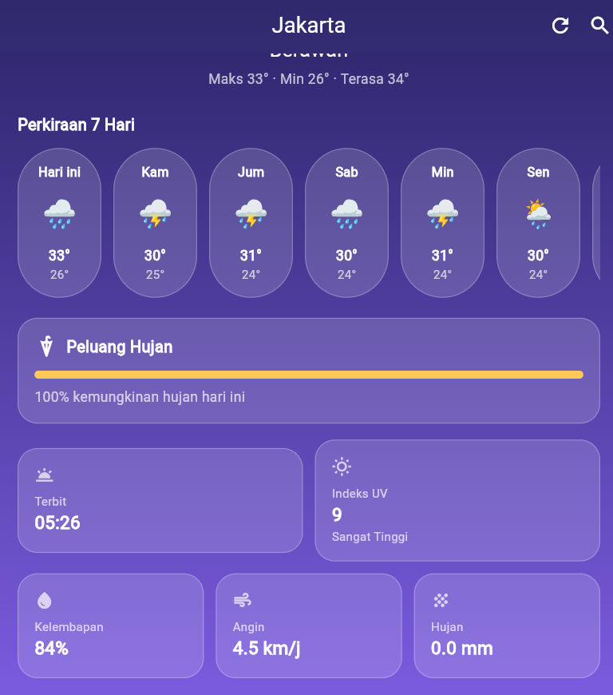
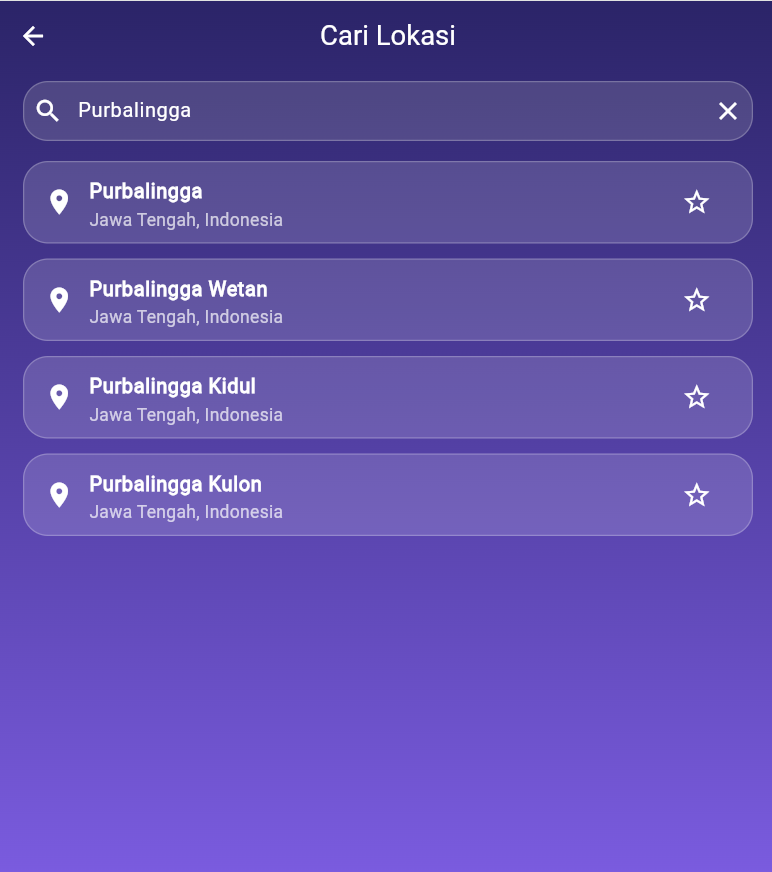

# Weather Forecasts

Aplikasi cuaca berbasis Flutter yang menampilkan kondisi cuaca terkini dan perkiraan 7 hari ke depan untuk kota mana pun di dunia. Data diambil dari REST API [Open-Meteo](https://open-meteo.com/).

Dibuat untuk memenuhi **Responsi Flutter**.

## Identitas

- **Nama:** Izzat Al Haq
- **NIM:** H1D024067
- **Program Studi:** Informatika, Fakultas Teknik, Universitas Jenderal Soedirman

## Screenshot

### Halaman Utama (Cuaca)

| Tampilan Atas | Tampilan Bawah | Pencarian Lokasi |
|---|---|---|
|  |  |  |

## Fitur

- Menampilkan nama kota dan wilayah yang sedang dipilih.
- Menampilkan suhu saat ini, suhu yang dirasakan, suhu maksimum dan minimum harian.
- Menampilkan kondisi cuaca dalam Bahasa Indonesia.
- Perkiraan cuaca 7 hari ke depan dalam daftar horizontal yang bisa digeser.
- Peluang hujan, waktu terbit matahari, dan indeks UV.
- Kelembapan udara, kecepatan angin, dan curah hujan.
- Pencarian kota berdasarkan nama.
- Menyimpan kota sebagai favorit.
- Mengingat kota terakhir yang dipilih saat aplikasi dibuka kembali.
- Menangani kondisi loading, data kosong, dan error, lengkap dengan tombol **Coba lagi**.

## Teknologi

- [Flutter](https://flutter.dev/) dan [Dart](https://dart.dev/)
- [Material Design 3](https://m3.material.io/)
- [provider](https://pub.dev/packages/provider) untuk pengelolaan state
- [http](https://pub.dev/packages/http) untuk HTTP request
- [shared_preferences](https://pub.dev/packages/shared_preferences) untuk penyimpanan lokal
- [Open-Meteo Forecast API](https://open-meteo.com/en/docs) dan [Geocoding API](https://open-meteo.com/en/docs/geocoding-api)

## Struktur Aplikasi

```
lib/
├── main.dart                     # Entry point, konfigurasi Provider dan tema
├── models/
│   ├── location.dart             # Model lokasi (nama, koordinat, wilayah)
│   └── weather.dart              # Model cuaca saat ini dan perkiraan harian
├── services/
│   ├── weather_service.dart      # HTTP GET ke Geocoding dan Forecast API
│   └── local_storage.dart        # Penyimpanan favorit dan lokasi terakhir
├── utils/
│   └── weather_code.dart         # Terjemahan kode cuaca WMO ke teks dan ikon
├── viewmodels/
│   ├── weather_view_model.dart   # State halaman cuaca
│   └── search_view_model.dart    # State halaman pencarian dan favorit
└── views/
    ├── home_screen.dart          # Halaman utama cuaca
    └── search_screen.dart        # Halaman pencarian lokasi
```

## Penerapan MVVM

Aplikasi ini menggunakan pola **Model-View-ViewModel (MVVM)**:

- **Model** (`models/`): representasi data dari JSON API dalam bentuk kelas Dart.
- **View** (`views/`): hanya menampilkan data. Layar mengambil ViewModel dengan `context.watch` dan memanggil aksi dengan `context.read`.
- **ViewModel** (`viewmodels/`): menyimpan state (`idle`, `loading`, `success`, `error`) dan logika aplikasi. ViewModel mewarisi `ChangeNotifier` dan memanggil `notifyListeners()` setiap kali data berubah.
- **Service** (`services/`): berkomunikasi dengan dunia luar, yaitu API dan penyimpanan lokal. ViewModel memanggil Service, bukan langsung ke API.

Alur data:

```
View  ──aksi──▶  ViewModel  ──panggil──▶  Service  ──HTTP GET──▶  Open-Meteo
View  ◀─notify─  ViewModel  ◀──JSON──   Service  ◀─────────────   (diubah jadi Model)
```

## Implementasi API

Aplikasi menggunakan dua endpoint Open-Meteo dengan metode **GET**.

**1. Geocoding API** untuk pencarian kota

```
GET https://geocoding-api.open-meteo.com/v1/search?name={kota}&count=10&language=id&format=json
```

**2. Forecast API** untuk data cuaca

```
GET https://api.open-meteo.com/v1/forecast?latitude={lat}&longitude={lon}
    &current=temperature_2m,relative_humidity_2m,apparent_temperature,precipitation,weather_code,wind_speed_10m
    &daily=weather_code,temperature_2m_max,temperature_2m_min,precipitation_probability_max,sunrise,sunset,uv_index_max
    &timezone=auto
```

Parameter `timezone=auto` membuat waktu terbit matahari mengikuti zona waktu lokasi yang dipilih.

Setiap request diberi batas waktu 15 detik. Jika status HTTP bukan 200, service melempar error yang kemudian ditangkap ViewModel dan ditampilkan ke pengguna.

## Penyimpanan Lokal

Data yang disimpan menggunakan `shared_preferences`:

- **Daftar favorit** disimpan sebagai list string berisi JSON lokasi.
- **Lokasi terakhir** disimpan sebagai satu string JSON. Saat aplikasi dibuka, lokasi ini dimuat ulang dan cuacanya langsung diambil.

## Cara Menjalankan

1. Pastikan Flutter SDK sudah terpasang dan `flutter doctor` tidak menunjukkan error penting.
2. Clone repository ini:

   ```bash
   git clone https://github.com/USERNAME/weather_forecast.git
   cd weather_forecast
   ```

3. Pasang dependency:

   ```bash
   flutter pub get
   ```

4. Jalankan aplikasi:

   ```bash
   flutter run
   ```

Aplikasi membutuhkan koneksi internet karena data cuaca diambil langsung dari API.

## Video Penjelasan

Video penjelasan kode: [tautan video](https://LINK_VIDEO_ANDA)

## Catatan

- Izin `INTERNET` sudah ditambahkan di `android/app/src/main/AndroidManifest.xml`.
- Lokasi default saat pertama kali dibuka adalah Jakarta.
- Ikon cuaca memakai emoji dan ikon Material. Ilustrasi 3D seperti pada desain referensi belum diterapkan.